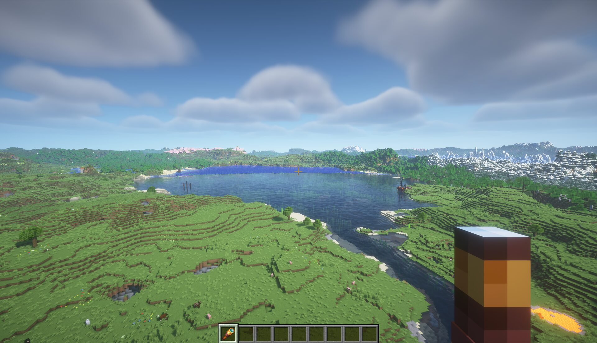

# Voxy — Apple M-Series Support

> **Status: ALPHA** — playable on Apple Silicon, under active development.
> First public pre-release: **0.2.8-alpha-metal.1** (Minecraft 1.21.11), on the
> [Releases](https://github.com/srjefers/voxy-mseries-support/releases) page.

A fork of [Voxy](https://github.com/MCRcortex/voxy) (the LOD rendering mod for
Minecraft) ported to run on **Apple M-series GPUs**. Upstream Voxy requires
OpenGL 4.6; macOS ships a frozen OpenGL 4.1, so this fork runs Voxy's entire
LOD renderer on **Metal** while Minecraft itself keeps rendering on GL, and
bridges the two worlds every frame through an IOSurface.



*Far terrain to the horizon on Apple Silicon: Voxy's LODs drawn with Metal
(Minecraft 1.21.11, with a shader pack).*

Tested on an Apple M4 Max (48 GB) with LOD terrain to the horizon; see
[System requirements](#system-requirements) for measured memory and frame
rates and for what smaller Macs need.

## Quick start (development environment)

Requirements: macOS on Apple Silicon, a JDK 21 to 25 to run Gradle (Gradle 9.2.1 does not
run on Java 26 or newer; see [Which Java runs what](docs/DEVELOPMENT.md#which-java-runs-what)),
this repository.

```bash
./gradlew runClient
```

The Metal render path is on by default. `VOXY_FORCE_METAL=0` turns it off
(Voxy disables itself and you get plain Sodium rendering). Older notes that
start the client with `VOXY_FORCE_METAL=1` still work; the variable is no
longer needed.

A dev run uses Java's default heap limit (25% of RAM). To measure what a
launcher profile with `-Xmx6G` would see, cap it the same way:

```bash
./gradlew runClient -PrunXmx=6G
```

To use the mod in a launcher profile, download the jar from
[Releases](https://github.com/srjefers/voxy-mseries-support/releases) (or build
it) and drop it in `mods/` together with the matching Sodium version. Voxy
turns on by itself; see [Java memory](#java-memory-and-turning-voxy-off) for
the recommended heap:

```bash
./gradlew build    # output: build/libs/voxy-<version>.jar
```

| Component | Version |
|---|---|
| Minecraft | 1.21.11 |
| Fabric Loader | 0.18.2+ |
| Fabric API | 0.140.0+ |
| Sodium (required) | mc1.21.11-0.8.1 |

## System requirements

Values marked † are estimates that have not been measured on that hardware
yet; everything else comes from the code or was measured on an Apple M4 Max
(48 GB, macOS 26) with the BSL shader pack.

### Hard requirements

| | Requirement |
|---|---|
| Chip | Apple Silicon, M1 or newer. On Intel Macs (or an x86_64 Java under Rosetta) Voxy turns itself off and the game runs with plain Sodium. |
| macOS | 13 Ventura or newer. Only macOS 26 has been tested. Jars built before commit `8f15d273` only load on macOS 26. |
| Java | Java 21, **arm64** (the launcher's bundled runtime). |
| Minecraft | 1.21.11 |
| Fabric Loader / Fabric API | 0.18.2 / 0.140.0+1.21.11 (tested versions) |
| Sodium | exactly `mc1.21.11-0.8.1`, required |
| Iris | `1.10.3+1.21.11-fabric`, optional (only for shader packs). Not 1.10.4 to 1.10.7: see below |
| Incompatible | voxyworldgenv2 2.2.2 |

**Iris with Sodium 0.8.1.** Iris 1.10.3 is the release built for Sodium 0.8.1:
Modrinth lists Sodium `mc1.21.11-0.8.1` as its dependency. Iris 1.10.4 to 1.10.7 also
install with Sodium 0.8.1, but each one changes Sodium's *Video Settings* screen for a
newer Sodium (`renderIconWithSpacing` gained a parameter in Sodium 0.8.2). With Sodium
0.8.1 that screen fails to load, so the button does nothing and Voxy's settings, which
live there, cannot be opened. Sodium 0.8.1 refuses Iris 1.10.2 and older at launch.
Iris 1.10.3 was tested in game with Voxy and BSL 10.1.3 on 2026-11-23, in the official
launcher with its default JVM arguments: *Video Settings* and Voxy's page open, LODs take
the pack's shading, and the log check passes.

### Java memory and turning Voxy off

Voxy needs no JVM arguments: on an Apple Silicon Mac it turns on by itself.
The launcher's default `-Xmx2G` is enough to play: in testing on 2026-11-23
the Java heap stayed below 90 % of 2 GB with and without BSL, because Voxy
keeps its LOD geometry outside the Java heap. More heap helps with Chunky
pre-generation and very large render distances. To raise it, change `-Xmx2G`
in the profile's JVM arguments (pick the value from the table below):

```
-Xmx6G
```

To turn Voxy off without removing the jar, add `-Dvoxy.forceMetal=false`
(or set the environment variable `VOXY_FORCE_METAL=0`): Voxy disables itself
and you get plain Sodium. Jars built before the on-by-default change still
need `-Dvoxy.forceMetal=true`.

### Tiers

| | Minimum | Recommended | Tested |
|---|---|---|---|
| Chip (GPU cores) | M1–M4 base, 7–10 cores† | M1–M4 Pro, 14–20 cores† | M4 Max, 40 cores |
| Unified memory | 16 GB | 24–32 GB | 48 GB |
| Java heap | `-Xmx2G` (the launcher's default) | `-Xmx4G`–`-Xmx6G` | `-Xmx2G` and `-Xmx6G` (the dev run defaulted to 12 GB) |
| Minecraft render distance | 8–12 chunks | 12–16 chunks | 32 chunks |
| Voxy render distance (menu value) | 256–512 chunks (512 is the default) | 512–1024 chunks | 2016 chunks |
| Voxy *Pixels² of subdivision size* | 128 | 96 | 96 |
| Shader pack | none | BSL with *Shadow Distance* 128 and *Shadowmap Quality* Low (1K)† | BSL defaults |
| Window | about 1080p | Retina window | 2848×1284 window |
| java process in Activity Monitor | ≈7–9 GB† | ≈9–12 GB† | ≈12–13 GB in a world with `-Xmx6G`, ≈15–16 GB with the default 12 GB limit; ≈1.6 GB before the first world (measured) |
| CPU (Activity Monitor, 100% = one core) | | | 110–230% while playing, 50–100% on the pause menu (measured, 16-core M4 Max) |

- Graphics settings follow the chip and `-Xmx` follows the memory, so read
  each row on its own (for example, a base M2 with 24 GB uses the Minimum
  graphics rows and `-Xmx6G`).
- **8 GB Macs are not supported.** An untested experiment: `-Xmx3G`, Voxy
  render distance 256 chunks or less, Minecraft render distance 8 or less, no
  shader pack. Leave the geometry arena at its 1 GB default (see the last
  point below).
- The Tested memory figures were measured over several leave-and-rejoin
  cycles without restarting the game. Memory levels off instead of growing:
  the GPU side, about 4.2 GB in a world, drops to about 0.4 GB on every
  return to the title screen. Most of the difference between the two figures
  is Java heap, which the JVM grows toward its limit, so `-Xmx6G` saves
  about 3 GB and played smoothly in testing.
- A lower Minecraft render distance moves work to Voxy, which draws far
  terrain much more cheaply.
- With BSL, lower *LOD Density* to about 0.25 (see Known issues).

**Measured frame rates (Tested tier, BSL defaults, Voxy render distance
2016 chunks, subdivision 96, vsync on at 120 Hz):** median about 37 FPS
(29–64) at 2848×1284, and 61–75 FPS at 1708×960. With vsync on, the frame
rate snaps to 120/n (60, 40, 30…), so a small extra cost can look like a
large drop. Other chips have not been measured†.

**Disk:** Voxy stores LODs only for terrain you explored, pre-generated or
imported, at about 5–11 KB per chunk (211 MB for 36,800 chunks measured).
Singleplayer data lives in `<world>/voxy/`, multiplayer data in
`.voxy/saves/`. Importing a Distant Horizons database needs the SQLite
driver, which Distant Horizons itself provides; without it the import command
does not appear.

### Why Activity Monitor shows much more than F3: unified memory

Apple Silicon GPUs have no separate video memory: the CPU and the GPU share
the same RAM. Everything Voxy hands to the GPU comes out of the same pool as
Minecraft's Java heap:

| What uses memory | Size |
|---|---|
| LOD geometry arena | physical RAM / 16, between 1 and 4 GB (1 GB on 16 GB, 3 GB on 48 GB). macOS keeps all of it resident as soon as the GPU uses it. |
| Block texture atlas | ≈0.5 GB |
| Other fixed Voxy buffers and driver overhead | ≈0.4 GB |
| Metal ↔ OpenGL frame bridges | ≈70 MB without a shader pack; with one, 68 bytes per pixel: ≈150 MB at 1080p, ≈260 MB at 2848×1284, ≈550 MB on a full-screen 16-inch MacBook Pro, ≈1 GB at 5K |
| Sodium's near-terrain buffers | ≈2.1 GB at 32 chunks, much less at 12–16 |
| Shader pack render targets and shadow maps | several hundred MB† |

- **F3 shows only the Java heap** (2.5 GB used of 12 GB in the tested
  session). Activity Monitor shows the whole process, including everything in
  the table above.
- **Voxy's own F3 lines are hidden by default** in Minecraft 1.21.11. Press
  F3+F6 to open *Debug Options*, find the row named `debug` and set it to
  *In Overlay* or *Always*. Voxy's rows are called `debug` and `version`, so
  searching for "voxy" finds nothing. The `version` row is always shown.
- **Do not give Java much more heap than it needs.** Java tends to grow into
  its `-Xmx` and rarely gives memory back, and on unified memory every GB of
  heap is a GB the GPU cannot use. Voxy's GPU memory is wired while in use, so
  it cannot be swapped out either.
- `-Dvoxy.geometryBufferSizeOverrideMB=<MB>` sets the geometry arena
  explicitly. Voxy starts evicting far LOD detail when less than 256 MB of the
  arena is free, so an arena below about 768 MB evicts all the time and far
  LODs pop in and out. A full or fragmented arena delays new LODs instead of
  crashing.

## Troubleshooting

- **The shader pack turned itself off.** If Voxy cannot build its renderer
  while a shader pack is active, Iris turns the pack off so the game keeps
  running. Since commit `5294dd9d` that change is not saved, and the log says
  why. Reloading shaders (R) or turning the pack back on tries it again, and
  so does the next launch. Older builds saved the change: turn the pack back
  on in *Options → Video Settings → Shader Packs*.
- **The world does not load after the shaders went off.** Builds before
  `afcb801d` crashed on every world join without a shader pack. Update to a
  newer build, or turn the pack back on as above.
- **Voxy's lines are missing from F3.** Press F3+F6 and set the row named
  `debug` to *In Overlay* in *Debug Options*.
- **The java thread count grows each time you rejoin a world.** Each
  singleplayer join adds about 6 threads that Voxy does not own. Vanilla
  Minecraft keeps 3 network threads per join and stops at 32 in total.
  Chunky adds 3 more, which exit after 5 idle minutes. Thread dumps over
  seven rejoins showed Voxy's own threads staying constant.
- **Frame rate drops in steps.** With vsync on the frame rate snaps to 60,
  40, 30 and so on. Turn vsync off to see the real cost.

## Testing and validation

The Metal port is checked against a test plan of 65 tests in nine phases:

1. Automated build and shader checks.
2. Starting without a shader pack.
3. BSL visuals.
4. Lifecycle and memory.
5. Failure paths.
6. Performance.
7. Underwater and caves.
8. World generation with Chunky.
9. The release jar in a clean launcher profile.

The plan runs on an Apple M4 Max, and each test's result is recorded.
**You can help test it on your own Mac:** the
[testing guide](docs/testing/README.md) has a short player track for a normal
launcher and the full developer track, and results go in a *Test report*
issue. The notes below come from that testing and explain log messages that
look alarming but are not errors.

### Log messages checked during testing

- **`[Metal-CULL] translucent-pass head: GL cull=OFF ... <- back faces of
  water WILL rasterise this frame`.** Without a shader pack this line can
  appear a few times per session, mostly while flying past mobs. It is a
  diagnostic left over from an earlier bug hunt, not an error, and water
  renders correctly. It was investigated on 2026-10-01 during test
  P1-NOPACK-START. Minecraft draws mobs and the block outline with face
  culling off just before the water pass. The probe reads that state a
  moment before Sodium turns culling back on for the water. The bug the
  probe was written for put Minecraft's own record of the culling state out
  of sync. It caused pale panes over water with a shader pack and was fixed
  in commit `cc18fabe`. That cannot happen without a pack, and with BSL the
  line does not appear at all.

## What works (alpha)

- LOD terrain to the horizon with **real baked block textures**, biome
  tinting, Minecraft lighting, and fog parity with Sodium's near terrain
- **Translucent, animated water** with correct underwater behavior (fog murk,
  no X-ray, stable visuals while swimming)
- Correct LOD↔terrain boundary (chunk-bound depth masking)
- Screenshots and render-distance changes
- Frame rates measured on an M4 Max are in
  [System requirements](#system-requirements) (synchronous GPU model — more
  headroom planned)

## Known issues / not yet done

Seen during the on-device test campaign for 0.2.8-alpha-metal.1 (details in
`docs/testing/`). None of them crashes the game.

- **Log noise after reloads and rejoins:** thousands of `Chunk already in map`
  warnings after *Apply* in Video Settings, the shader toggle (K) or leaving
  and re-entering a world in the same session. Untested risk: re-entering a
  different world or place in the same session could leave a square hole in
  the LODs until a restart.
- After *Enable Voxy* OFF → ON, the mask that hides LODs under nearby chunks
  can stay incomplete until the next reload.
- **Holes in LOD terrain** inside an area pre-generated with Chunky were seen
  once (empty rectangles that fill in when you get close). The latest test, on
  a fresh 4 × 4 km Chunky area, had none.
- **LOD trees** can show a single leaf colour until their chunks load.
- **Seen from high above the ocean:** a grey wall, sometimes with a thin gap,
  where nearby water meets LOD water, and thin dotted lines on far LOD water.
  Cosmetic.
- **Spyglass and zoom:** visual glitches have been reported; not yet
  documented.
- **With BSL:** distant grass can look brighter, as if unshadowed, away from
  noon; and up to three rings can show at the LOD border.
- **LOD water animation phase** can be slightly offset from MC's water, and
  flowing water (rivers/waterfalls seen up close) uses a static frame —
  accepted open issue.
- **SSAO** is not ported (an interim brightness compensation matches LOD
  terrain to Sodium's ambient-occlusion look).
- **Sky at the horizon** is the fog color rather than MC's real sky, and
  white clouds can be hard to see against it at day (MC 1.21.11 renders the
  sky in a way the compositor cannot yet preserve).
- **Performance phase 2** pending: the Metal frame currently uses 3
  synchronous GPU waits; collapsing them is the main planned frame-rate gain.
- **Iris shader packs now drive LOD terrain on Metal** through Voxy's native
  pack contract (packs shipping `voxy.json`, e.g. BSL): LOD depth goes to the
  pack's dedicated `vxDepthTex` side-channel and the pack's own `#ifdef VOXY`
  branches apply fog, AO, shadows and clouds to LOD pixels. Full per-pixel
  pack lighting of LODs (material g-buffer resolve) is in progress
  (milestone "Native Iris shader contract on Metal").
- **BSL fog tuning for LOD view distances**: BSL applies its full fog density
  across LOD distances by default, washing the far field out white. Lower
  *Shader Pack Settings → Environment → Fog → More Fog Density Config → LOD
  Density* to ~0.25 (BSL added that slider specifically for LOD mods). Equivalent file
  setting: `FOG_DENSITY_LOD=0.25` in `shaderpacks/<pack>.zip.txt`.

## Documentation

- [`docs/METAL-MIGRATION.md`](docs/METAL-MIGRATION.md) — architecture, the
  root-cause/fix table, the full environment-variable reference, backlog.
- [`docs/MIGRATION-HISTORY.md`](docs/MIGRATION-HISTORY.md) — the complete
  journey: every milestone, bug, root cause, and fix that got this working.
- [`docs/testing/README.md`](docs/testing/README.md) — how to test the mod on
  your Mac and report results; helper scripts are in `scripts/testing/`.
- [`docs/DEVELOPMENT.md`](docs/DEVELOPMENT.md) — building, running,
  debugging workflow, log markers, and contribution conventions.
- [`docs/LOD-FLICKER-INVESTIGATION.md`](docs/LOD-FLICKER-INVESTIGATION.md) —
  historical investigation notes (May 2026).

## Credits and thanks

**Voxy.** This fork exists because of [Voxy](https://github.com/MCRcortex/voxy),
created by [MCRcortex](https://github.com/MCRcortex) (Cortex). The LOD
engine, the storage, the voxelization and the renderer this port moves onto
Metal are their work. Thanks also to everyone who contributed to upstream
Voxy: [KaptainWutax](https://github.com/KaptainWutax),
[boredhuman](https://github.com/boredhuman), [zea64](https://github.com/zea64),
[Philanche](https://github.com/Philanche),
[Samalando](https://github.com/Samalando),
[Xenthio](https://github.com/Xenthio), [drouarb](https://github.com/drouarb)
and [rhysdh540](https://github.com/rhysdh540)
([full list](https://github.com/MCRcortex/voxy/graphs/contributors)). Voxy is
All Rights Reserved. The upstream developers know about this fork and had no
objection to its builds; they will be taken down if they ask.

**Contributors to this fork.** Thank you to the people who sent pull requests:

- [justAnArthur](https://github.com/justAnArthur): fixes for LODs, packaging
  and addon linking in launcher installs (#25), Metal culling and draw batching with Create/Flywheel
  and world-loading fixes (#27), the shader smoke-test fix (#38), and the
  detailed reports #28–#37. Issue #37 proposed turning the Metal path on by
  default, which 0.2.8-alpha-metal.1 does.
- [BrekkeLiten](https://github.com/BrekkeLiten): the port of the Metal
  backend to Minecraft 26.3 with Voxy 0.2.20 and Sodium 0.9 (#24).
- [NidaleNieve](https://github.com/NidaleNieve): adapting Voxy 0.2.16 to
  1.21.11 on Metal and stabilizing Sodium/Iris rendering (#22).

**Special thanks** to [pamms0606-sketch](https://github.com/pamms0606-sketch),
who hand-patched an early jar and reported the launcher crash that shaped the
release checks (#18), and to [udmur1](https://github.com/udmur1), who showed
the port running on Minecraft 26.3 (#23).

Voxy for Apple Silicon also stands on [Sodium](https://github.com/CaffeineMC/sodium),
[Iris](https://github.com/IrisShaders/Iris), [Fabric](https://fabricmc.net/)
and [LWJGL](https://www.lwjgl.org/) (shaderc and SPIRV-Cross for the
GLSL → MSL path).

Port and stabilization work: see `docs/MIGRATION-HISTORY.md`.
